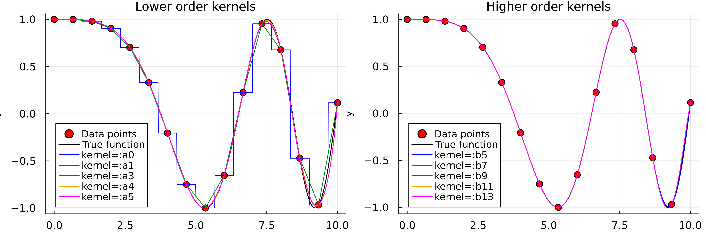

# ConvolutionInterpolations.jl

High-order interpolation, differentiation, integration and smoothing on discrete samples in arbitrary dimensions.

[](fig/convolution_interpolation_kernels.png)

ConvolutionInterpolations.jl interpolates data by convolution with a piecewise-polynomial kernel, from nearest-neighbour to a C¹¹ smooth 13th-degree kernel, on uniform and nonuniform grids, in any number of dimensions. The interpolant is differentiated and integrated analytically, smoothed, or built from scattered points by fitting a grid to them, all through one interface.

- **High-order kernels**: 7th-order convergence on uniform grids, up to 14th on nonuniform ones
- **Exact evaluation**: kernel weights computed exactly from the polynomial pieces, in any precision
- **O(1) evaluation**: query time independent of grid size, allocation-free
- **Any dimension**: separable kernels, with lazy construction for large grids
- **Derivatives up to 7th order** and **repeated integrals up to 8th**, mixed per axis, from the same samples
- **Scattered data**: smoothing fits with automatically chosen smoothing, or exact interpolation, with derivatives and integrals
- **Gaussian smoothing** of noisy gridded data and **grid-to-grid resampling**

## Documentation

The documentation lives at [convinterp.org](https://convinterp.org): concept pages for each capability, [benchmarks](https://convinterp.org/benchmarks/julia/) against Interpolations.jl, BSplineKit.jl, Dierckx.jl and the scattered-data packages, the [theory](https://convinterp.org/theory.html) behind the kernels, the [API reference](https://convinterp.org/julia/api.html) and the [release notes](https://convinterp.org/julia/releases.html). The same site documents [convinterp](https://github.com/NikoBiele/convinterp), the Python port with a Rust core by the same author.

## Installation

```julia
using Pkg
Pkg.add("ConvolutionInterpolations")
```

## A first example

A sine sampled at fifty points, interpolated with the default `:b7` kernel and evaluated between the samples, with its derivative and its integral from the same fifty values:

```julia
using ConvolutionInterpolations

x = range(0, 2π, length = 50)                             # fifty uniformly spaced samples
y = sin.(x)                                               # the values at the samples

itp = convolution_interpolation(x, y)                     # the interpolant, default kernel :b7
d_itp = convolution_interpolation(x, y; derivative = 1)   # the derivative of the interpolant
i_itp = convolution_interpolation(x, y; derivative = -1)  # its integral, zero at x = 0

itp(1.0), d_itp(1.0), i_itp(1.0)                          # evaluate between the samples
```

| | f(1) | f′(1) | ∫₀¹ f |
|:--|--:|--:|--:|
| from fifty samples | 0.841470984879974 | 0.540302305515489 | 0.459697694147643 |
| exact | 0.841470984807897 | 0.540302305868140 | 0.459697694131860 |

Ten correct digits from fifty samples per period, and the error keeps falling as the 7th power of the spacing as samples are added.

## The interface at a glance

Every capability is a keyword of `convolution_interpolation`, or one of four companion functions. Each call below is complete:

```julia
using ConvolutionInterpolations

# gridded data: a vector or range of knots per axis, and an array of values
xs = range(-1, 1, length = 41)                            # a uniform axis
ys = range(0, 2, length = 61)                             # another
z = [sin(3x) * cos(2y) for x in xs, y in ys]              # values on the 2D grid

itp = convolution_interpolation((xs, ys), z)              # 2D interpolant, default kernel :b7
itp(0.3, 1.2)                                             # evaluate anywhere inside the grid

itp_x = convolution_interpolation((xs, ys), z; derivative = (1, 0))    # ∂/∂x of the interpolant
itp_I = convolution_interpolation((xs, ys), z; derivative = (-1, -1))  # ∫∫ from the corner of the grid
itp_a4 = convolution_interpolation((xs, ys), z; kernel = :a4)          # a narrower kernel, cheaper in many dimensions

xn = sort(rand(30))                                       # nonuniform knots are detected automatically
itp_n = convolution_interpolation(xn, sin.(2π .* xn))     # the nonuniform :b7 kernel
itp_e = convolution_interpolation(xs, sin.(xs); extrap = :line)   # linear extrapolation outside the grid

xl = range(0, 1, length = 400)                            # a large grid is built lazily by default:
itp_3d = convolution_interpolation((xl, xl, xl), rand(400, 400, 400))   # ghost points computed on the fly at the boundaries

z_smooth = convolution_smooth((xs, ys), z .+ 0.05 .* randn(41, 61), 0.1)   # Gaussian smoothing of noisy gridded data
z_fine = convolution_resample((xs, ys), (range(-1, 1, length = 201), range(0, 2, length = 301)), z)   # resample to a finer grid

# scattered data: a d × n matrix of points, one per column, and a vector of values
pts = rand(2, 800)
vals = [sin(3p[1]) * cos(2p[2]) + 0.05 * randn() for p in eachcol(pts)]   # noisy measurements
fit = convolution_interpolation(pts, vals)                # smoothing fit, smoothing chosen by cross-validation
fit_x = convolution_interpolation(pts, vals; derivative = (1, 0))        # and its derivative
knots, grid, info = fit_scattered(pts, vals)              # the fitted grid itself, with the chosen smoothing and estimated noise
exact = convolution_interpolation(pts, vals; mode = :exact)   # for trusted data: passes through every point
```

The docstrings (`?convolution_interpolation`, `?fit_scattered`, `?convolution_smooth`, `?convolution_resample`, `?convolution_gaussian`) describe every keyword; the [concept pages](https://convinterp.org) show each capability worked through.

## Kernels

Uniform grids:

| Kernel | Degree | Continuity | Derivative range | Convergence | Stencil |
|--------|--------|------------|------------------|-------------|---------|
| `:a0`  | 0      | —          | -2..0            | 1st order   | 2ᴺ      |
| `:a1`  | 1      | C⁰         | -2..0            | 2nd order   | 2ᴺ      |
| `:a3`  | 3      | C¹         | -4..1            | 3rd order   | 4ᴺ      |
| `:a4`  | 3      | C¹         | -4..1            | 4th order   | 6ᴺ      |
| `:a5`  | 5      | C³         | -4..1            | 3rd order   | 6ᴺ      |
| `:a7`  | 7      | C⁵         | -4..1            | 3rd order   | 8ᴺ      |
| `:b5`  | 5      | C³         | -6..3            | 6th order   | 10ᴺ     |
| `:b7`  | 7      | C⁵         | -8..5            | 7th order   | 12ᴺ     |
| `:b9`  | 9      | C⁷         | -8..6            | 7th order   | 14ᴺ     |
| `:b11` | 11     | C⁹         | -8..7            | 7th order   | 16ᴺ     |
| `:b13` | 13     | C¹¹        | -8..7            | 7th order   | 18ᴺ     |

Nonuniform grids:

| Kernel | Degree | Continuity | Derivative range | Convergence | Stencil |
|--------|--------|------------|------------------|-------------|---------|
| `:a0`  | 0      | —          | —                | 1st order   | 2ᴺ      |
| `:a1`  | 1      | C⁰         | 0..0             | 2nd order   | 2ᴺ      |
| `:n3`  | 3      | C¹         | 0..0             | 3rd order   | 4ᴺ      |
| `:b5`  | 5      | C³         | 0..3             | 6th order   | 10ᴺ     |
| `:b7`  | 7      | C⁵         | 0..5             | 8th order   | 12ᴺ     |
| `:b9`  | 9      | C⁷         | 0..6             | 10th order  | 14ᴺ     |
| `:b11` | 11     | C⁹         | 0..7             | 12th order  | 16ᴺ     |
| `:b13` | 13     | C¹¹        | 0..7             | 14th order  | 18ᴺ     |

The default `:b7` works everywhere: uniform and nonuniform grids, derivatives, integrals, lazy mode, any dimension. The nonuniform `b` kernels converge at order degree + 1, since their per-interval weights enforce polynomial reproduction up to the kernel's full degree; `:n3` is the nonuniform form of `:a3`, and the two names are interchangeable.

## Choosing a kernel

- **Default `:b7` works everywhere**: 7th-order accuracy on uniform grids, nonuniform grids, high-order derivatives
- **Lazy mode for large grids**: chosen automatically when eager expansion would be costly; saves memory and construction time
- **Use `:a0`, `:a1` or `:a3` in high dimensions**: evaluation time of narrower kernels scales better with dimension
- **Any precision works out of the box**: `Float32` and `BigFloat` interpolants use the exact kernel coefficients rounded to their own precision
- **Orthogonal grids assumption**: the separable kernel design requires mutually orthogonal grid axes
- **Use `mode = :exact` for trusted scattered data**: exact fit with derivatives and box integrals
- **Keep the default smoothing for noisy scattered data**: smoothing chosen automatically, with an estimate of the noise level
- **Use `convolution_smooth` before interpolating noisy gridded data**: separable Gaussian smoothing with B ≈ 0.1 recommended
- **Use `convolution_resample` for grid-to-grid operations**: faster than construct + evaluate, exploits separability

## Citing

If you use this package in your work, please cite it. Every release is archived on Zenodo; the DOI below always refers to the latest version, and the Zenodo record lists the DOIs of the individual versions. `CITATION.cff` in this repository has the details, also under "Cite this repository" on GitHub.

> Bielefeld, N. M. (2026). *ConvolutionInterpolations.jl: high-order convolution interpolation*. Zenodo. <https://doi.org/10.5281/zenodo.23354656>

```bibtex
@software{bielefeld_convolutioninterpolations,
  author    = {Bielefeld, Nikolaj Maack},
  title     = {ConvolutionInterpolations.jl: high-order convolution interpolation},
  year      = {2026},
  publisher = {Zenodo},
  doi       = {10.5281/zenodo.23354656},
  url       = {https://convinterp.org}
}
```

## Acknowledgments

ConvolutionInterpolations.jl draws significant inspiration from [Interpolations.jl](https://github.com/JuliaMath/Interpolations.jl) in terms of API design and interface patterns. This package originally started as a PR for Interpolations.jl before evolving into a standalone implementation.

The theoretical foundation builds on:

- R. G. Keys, "Cubic Convolution Interpolation for Digital Image Processing," *IEEE Trans. Acoustics, Speech, and Signal Processing*, vol. 29, no. 6, 1981.
- E. H. W. Meijering, K. J. Zuiderveld, and M. A. Viergever, "Image Reconstruction by Convolution with Symmetrical Piecewise nth-Order Polynomial Kernels," *IEEE Trans. Image Processing*, vol. 8, no. 2, 1999.

## Declaration of AI Assistance

Parts of this package and its documentation were developed with assistance from Claude (Anthropic). All code, methods, and scientific content have been verified and validated by the author.

## License

MIT, see [LICENSE](LICENSE).